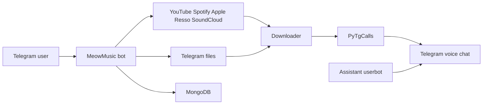

<div id="top"></div>

<p align="center">
  
</p>

<p align="center">
  
</p>

<p align="center">
  
</p>

<p align="center">
  <a href="https://github.com/Kanha-Team/MeowMusic/stargazers"></a>
  <a href="https://github.com/Kanha-Team/MeowMusic/network/members"></a>
  
  
  
  <a href="https://t.me/MeowClone"></a>
  <a href="./LICENSE"></a>
</p>

<p align="center">
  Stream audio and video into Telegram group and channel voice chats.<br/>
  Queue, skip, pause, resume, playlists, and group tools in one bot.
</p>

---

## Highlights

- **Voice chat streaming:** Audio and video playback in group and channel voice chats through an assistant account and PyTgCalls.
- **Multi-source playback:** YouTube search, URLs and playlists, Spotify metadata, Apple Music, Resso, SoundCloud, and Telegram files.
- **Full queue control:** Play, skip, seek, pause, resume, loop, shuffle, speed, and live queue editing.
- **Channel play:** Bind a channel to a group and control playback from the linked channel.
- **Playlist system:** Save, load, expand, and manage per-chat playlists in MongoDB.
- **Admin suite:** Auth users, promote, demote, ban, mute, purge, tag, and playback rights.
- **Owner and sudo tools:** Broadcast, gban, blacklist chats, logs, maintenance, auto-end, and live updates.
- **Built-in tools:** GPT chat, translation, weather, image processing, stickers, speedtest, whois, and more.
- **Docker and Heroku ready:** One-command container build plus `app.json` and `heroku.yml` templates.

---

## How it works



| Source | What plays |
| :--- | :--- |
| YouTube | Search, URL, playlist |
| Spotify | Track and playlist metadata |
| Apple Music | Track links |
| Resso | Track links |
| SoundCloud | Track links |
| Telegram | Replied audio, video, document |
| Live URL | Direct stream |

---

## Quick Deploy

<details>
<summary><b>Click to expand - VPS / Linux Server Build Guide</b></summary>
<br/>

### Prerequisites

```bash
sudo apt-get update && sudo apt-get upgrade -y
sudo apt-get install -y git curl ffmpeg python3-venv python3-pip
curl -fsSL https://deb.nodesource.com/setup_20.x | sudo bash -
sudo apt-get install -y nodejs
curl -LsSf https://astral.sh/uv/install.sh | sh
export PATH="$HOME/.local/bin:$PATH"
```

### Step-by-Step Setup

```bash
# 1. Clone the repository
git clone https://github.com/Kanha-Team/MeowMusic MeowMusic
cd MeowMusic

# 2. Install locked dependencies
uv sync

# 3. Fix the SafoneAPI / pyrogram clash
#    SafoneAPI pulls pyrogram 2.0.106 which overwrites kurigram
#    and breaks pyrogram.raw.types. Force kurigram back on:
uv pip uninstall pyrogram
uv pip install --reinstall kurigram

# 4. Configure environment
cp sample.env .env
nano .env

# 5. Run
bash start
```

`start` runs `python3 -m MeowMusic` and picks up `venv` or `.venv` automatically.

### Running 24/7 in Background

**Method 1: Tmux**

```bash
tmux new -s meowmusic
bash start
# Press Ctrl+B then D to detach. Re-attach anytime with: tmux a -t meowmusic
```

**Method 2: Systemd Service**

```bash
sudo nano /etc/systemd/system/meowmusic.service
```

```ini
[Unit]
Description=MeowMusic Telegram Music Bot
After=network.target

[Service]
Type=simple
User=ubuntu
WorkingDirectory=/home/ubuntu/MeowMusic
ExecStart=/home/ubuntu/MeowMusic/.venv/bin/python -m MeowMusic
Restart=always
RestartSec=5

[Install]
WantedBy=multi-user.target
```

Enable and start the service:

```bash
sudo systemctl daemon-reload
sudo systemctl enable meowmusic
sudo systemctl start meowmusic
sudo systemctl status meowmusic
```

</details>

<details>
<summary><b>Click to expand - Docker Build Guide</b></summary>
<br/>

```bash
git clone https://github.com/Kanha-Team/MeowMusic MeowMusic
cd MeowMusic
cp sample.env .env
nano .env

# 1. Remove the old container (skip the error if it does not exist yet)
docker rm -f meowmusic-bot

# 2. Build a fresh image from uv.lock
docker build --no-cache -t meowmusic .

# 3. Start the bot in the background and keep it alive across reboots
docker run -d --restart=always --name meowmusic-bot --env-file .env meowmusic

# 4. Follow live logs
docker logs -f meowmusic-bot
```

The image uses Python 3.12, uv, FFmpeg, Node 20, and `uv sync --no-dev` with the kurigram fix applied. Dependencies come from `uv.lock`; no `requirements.txt` is used.

To redeploy after pulling new code, rebuild and replace the container:

```bash
git pull
docker rm -f meowmusic-bot
docker build --no-cache -t meowmusic .
docker run -d --restart=always --name meowmusic-bot --env-file .env meowmusic
docker logs -f meowmusic-bot
```

</details>

<details>
<summary><b>Click to expand - Heroku Deploy Guide</b></summary>
<br/>

Use `app.json` / `heroku.yml`. Enable the **worker** dyno. Start command is `bash start`.

Required config vars: `API_ID`, `API_HASH`, `BOT_TOKEN`, `STRING_SESSION`, `MONGO_DB_URI`, `LOGGER_ID`, `OWNER_ID`.

</details>

---

## Configuration Variables

<details open>
<summary><b>Environment Variables Reference Table</b></summary>
<br/>

| Variable | Required | Default | Description |
| :--- | :---: | :--- | :--- |
| `API_ID` | **Yes** | — | Telegram API ID from [my.telegram.org](https://my.telegram.org) |
| `API_HASH` | **Yes** | — | Telegram API Hash from [my.telegram.org](https://my.telegram.org) |
| `BOT_TOKEN` | **Yes** | — | Bot token from [@BotFather](https://t.me/BotFather) |
| `STRING_SESSION` | **Yes** | — | Pyrogram v2 string session for assistant 1 |
| `MONGO_DB_URI` | **Yes** | — | MongoDB connection URI, Atlas free tier works |
| `LOGGER_ID` | **Yes** | — | Log group ID (`-100...`), bot must be admin |
| `OWNER_ID` | **Yes** | — | Telegram user ID of the bot owner |
| `STRING_SESSION2` | No | — | Second assistant string session |
| `STRING_SESSION3` - `STRING_SESSION6` | No | — | Extra assistant string sessions |
| `BOT_USERNAME` | No | `MeowClonerBot` | Bot username used in start text |
| `BOT_NAME` | No | — | Display name shown in the start message |
| `ASSUSERNAME` | No | — | Assistant username for mentions |
| `OWNER_USERNAME` | No | `xoknha` | Owner username shown in the bot |
| `DURATION_LIMIT` | No | `17000` | Max track duration in minutes |
| `DB_NAME` | No | `MeowMusic` | MongoDB database name |
| `DISABLE_COLOUR` | No | `False` | Disable colored playback buttons |
| `PRIVACY_LINK` | No | telegra.ph page | Privacy policy link shown in the bot |
| `SUPPORT_CHANNEL` | No | `https://t.me/MeowCloner` | Channel link shown in the bot |
| `SUPPORT_CHAT` | No | `https://t.me/MeowClone` | Support group link shown in the bot |
| `AUTO_LEAVING_ASSISTANT` | No | `True` | Assistant auto-leaves empty voice chats |
| `ASSISTANT_LEAVE_TIME` | No | `9000` | Seconds before the assistant leaves |
| `SONG_DOWNLOAD_DURATION` | No | `9999999` | Max download duration for songs |
| `SONG_DOWNLOAD_DURATION_LIMIT` | No | `9999999` | Hard limit on song downloads |
| `PLAYLIST_FETCH_LIMIT` | No | `25` | Playlist items fetched per request |
| `SPOTIFY_CLIENT_ID` | No | built-in | Spotify API client ID |
| `SPOTIFY_CLIENT_SECRET` | No | built-in | Spotify API client secret |
| `TG_AUDIO_FILESIZE_LIMIT` | No | `5242880000` | Telegram audio upload size limit |
| `TG_VIDEO_FILESIZE_LIMIT` | No | `5242880000` | Telegram video upload size limit |
| `START_IMG_URL` | No | hosted image | Image shown on /start |
| `HELP_IMG_URL` | No | hosted image | Image shown in /help |
| `PING_IMG_URL` | No | hosted image | Image shown in /ping |
| `HEROKU_APP_NAME` | No | — | Heroku app name for update commands |
| `HEROKU_API_KEY` | No | — | Heroku API key for update commands |
| `UPSTREAM_REPO` | No | `https://github.com/Kanha-Team/MeowMusic` | Git source for update commands |
| `UPSTREAM_BRANCH` | No | `main` | Git branch for update commands |
| `GIT_TOKEN` | No | — | Git token for private upstream repos |

</details>

Never commit `.env`, `*.session`, or `cookies/cookies.txt`. They are gitignored.

---

## Bot Commands Reference

<details>
<summary><b>Click to expand - Playback and Stream Commands</b></summary>
<br/>

| Command | Description |
| :--- | :--- |
| `/play <query or url>` | Streams audio into the group voice chat |
| `/vplay <query or url>` | Streams track with video rendering enabled |
| `/cplay` | Play in a linked channel voice chat |
| `/cvplay` | Video play in a linked channel voice chat |
| `/playforce` | Force play bypassing queue as owner or sudo |
| `/vplayforce` | Force video play bypassing queue |
| `/cplayforce` `/cvplayforce` | Force play variants for linked channels |
| `/skip` `/next` | Skip to the next queued track |
| `/cskip` `/cnext` | Skip from the linked channel |
| `/pause` `/cpause` | Pause the active stream |
| `/resume` `/cresume` | Resume a paused stream |
| `/stop` `/end` `/cstop` `/cend` | Stop playback and clear the queue |
| `/seek <seconds>` | Seek forward in the current track |
| `/seekback <seconds>` | Seek backward in the current track |
| `/cseek` `/cseekback` | Seek from the linked channel |
| `/speed` `/slow` | Open the speed control panel |
| `/loop <1-10>` | Set loop count, `/loop enable` sets it to 10 |
| `/cloop` | Loop control from the linked channel |
| `/shuffle` `/cshuffle` | Shuffle the queue |
| `/queue` `/player` `/playing` | Live queue and track info with controls |
| `/cqueue` `/cplayer` `/cplaying` | Live queue and track info from the linked channel |
| `/mode` `/playmode` | Open playback mode settings |
| `/channelplay` | Link or unlink a channel for playback |
| `/song <name>` | Download and send the audio file in private chat |
| `/cancel` | Abort an active download |
| `/playlist` `/plist` | Show saved playlists |
| `/addsong` `/addplay` | Save current or given track to playlist |
| `/delsong` `/rmsong` | Remove a track from saved playlist |
| `/playplaylist` `/pplay` | Play a saved playlist |
| `/cloneplaylist` `/cloneplist` | Clone another group playlist |
| `/delplaylist` | Delete a saved playlist |

</details>

<details>
<summary><b>Click to expand - Group Admin and Settings Commands</b></summary>
<br/>

| Command | Description |
| :--- | :--- |
| `/auth <user>` | Authorize a non-admin user for playback commands |
| `/unauth <user>` | Revoke playback authorization from a user |
| `/authlist` `/authusers` | List authorized users in the group |
| `/promote` `/fullpromote` | Promote a member with admin rights |
| `/demote` | Revoke admin rights from a member |
| `/ban` `/unban` | Ban or unban a user |
| `/tban` `/tmute` | Temporary ban or mute with duration |
| `/sban` | Silent ban without a reply message |
| `/mute` `/unmute` | Mute or unmute a member |
| `/kick` | Kick a member from the group |
| `/purge` `/spurge` | Delete replied messages |
| `/unpinall` | Unpin all messages |
| `/tag` `/tagall` | Mention all or replied members |
| `/mention` | Mention admins or members by title |
| `/user` | Export the member list as a CSV file, admin only |
| `/lock` `/unlock` `/locktypes` `/locked` | Manage locked command types |
| `/userbotjoin` `/userbotleave` | Move the assistant in or out of the chat |
| `/leaveall` | Leave all groups as sudo |
| `/language` `/lang` `/setlang` | Change group language |
| `/settings` `/setting` | Open group playback settings panel |
| `/nightmode` | Toggle automatic night mode scheduling |
| `/filter` `/filters` `/stopfilter` | Manage per-group custom filters |
| `/notes` `/save` `/saved` `/clear` | Manage notes and welcome messages |
| `/chatbot` | Enable or disable group chatbot |
| `/gmoff` `/gmstop` | Turn off good morning messages |
| `/gnoffcancle` `/gnstop` | Turn off good night messages |
| `/shayari` `/shayarioff` | Toggle random shayari replies |
| `/hitag` `/etag` `/utag` `/atag` | Title based tag commands |

</details>

<details>
<summary><b>Click to expand - Owner and Sudo Commands</b></summary>
<br/>

| Command | Description |
| :--- | :--- |
| `/addsudo` `/delsudo` `/delallsudo` | Add or remove a sudo user |
| `/sudolist` `/listsudo` `/sudoers` | List current sudoers |
| `/gban` `/ungban` | Global ban or unban a user |
| `/gbanlist` `/gbannedusers` | List globally banned users |
| `/globalban` | Alias for global ban |
| `/block` `/unblock` | Block or unblock a user globally |
| `/blockedusers` `/blusers` | List blocked users |
| `/blacklistchat` `/whitelistchat` | Restrict or allow the bot in a chat |
| `/blchats` `/blacklistedchats` | List blacklisted chats |
| `/unblchat` | Remove a chat from the blacklist |
| `/broadcast` | Message all served chats |
| `/post` `/cpost` | Post to the log channel |
| `/send` | Send a message as the bot |
| `/gcast` | Global cast to many groups |
| `/raid` `/stopraid` `/uraid` | Start or stop raid mode |
| `/logger` `/logs` `/getlog` `/getlogs` | Fetch or post log group messages |
| `/maintenance` | Toggle maintenance mode |
| `/autoend` | Configure automatic stream end |
| `/checkrights` | Verify bot rights in chats |
| `/restart` | Restart the bot process |
| `/update` `/gitpull` | Pull latest code from upstream |
| `/gitconfig` `/gitupload` | Inspect or set upstream git config |
| `/cookies` | Manage YouTube cookies |
| `/mongochk` | Check MongoDB connectivity |

</details>

<details>
<summary><b>Click to expand - Tools and Utility Commands</b></summary>
<br/>

| Command | Description |
| :--- | :--- |
| `/ping` | Live latency plus CPU, RAM, disk, and PyTgCalls stats |
| `/stats` `/gstats` | Bot and global usage stats panel |
| `/dbstats` | MongoDB collection counts |
| `/activevc` `/activevoice` `/vc` | List active voice chats, sudo only |
| `/activev` `/activevideo` `/vvc` | List active video chats, sudo only |
| `/ac` `/av` | List all active chats, sudo only |
| `/admins` `/staff` | List group admins |
| `/bots` | List bots in the group |
| `/afk` | Mark yourself away with a reason |
| `/gpt` `/chatgpt` `/ai` `/ask` `/solve` | Chat with an AI assistant |
| `/tr <lang>` | Translate a replied message |
| `/calendar` | Generate a calendar image for a month |
| `/carbon` | Code snippet to carbon image |
| `/mmf` | Meme text on image |
| `/google` | Google search results |
| `/ig` `/instagram` `/reel` | Instagram and reel downloads |
| `/imposter` | Imposter game stats |
| `/couple` `/divorce` | Couple or divorce percentage |
| `/kang` | Kang a sticker to your pack |
| `/packkang` | Kang a whole sticker pack |
| `/stickerid` `/stid` | Show the id of a replied sticker |
| `/st` | Send a sticker by its id |
| `/sendsticker` | Send a sticker from a pack |
| `/packsticker` | List a sticker pack |
| `/telegraph` `/tgm` `/tgt` `/tl` | Upload media to Telegraph |
| `/paste` | Paste text to a bin service |
| `/bin` `/bininfo` `/ccbin` | Bin lookup and card info |
| `/ccgen` `/gen` | Generate test card numbers |
| `/speedtest` `/spt` | Run a server speed test |
| `/whois` | User or domain whois lookup |
| `/id` | Show chat and user ids |
| `/phone` | Phone number lookup |
| `/webshot` `/ss` `/webss` | Website screenshot |
| `/zip` `/unzip` | Compress or extract files |
| `/pdf` | Convert image to PDF |
| `/tts` | Text to speech |
| `/math <expression>` | Evaluate a math expression |
| `/spg <query>` | Google search with a next-page button |
| `/leavegroup` | Make the bot leave the group, owner only |
| `/song` | Download a song from YouTube in private chat |
| `/search <query>` | YouTube search, top 5 results |
| `/tg <query>` | Google custom search results |
| `/q` `/r` | Quote a replied message |
| `/eval` `/sh` | Run code or shell as owner |
| `/admincache` `/reload` `/refresh` `/reboot` | Refresh admin and module caches |
| `/report` `/admin` | Report a message to admins |
| `/reverse` `/sauce` `/pp` | Reverse image search |
| `/zombies` `/clean` | Find and remove deleted accounts |
| `/welcome` | Toggle welcome messages |
| `/github` `/git` | GitHub repo lookup |
| `/repo` `/source` | Show source repo |

</details>

Prefix can be changed in config. Admin commands need rights in the group. Sudo commands need `OWNER_ID` or sudo status.

---

## Project Architecture

```text
MeowMusic/
├── MeowMusic/
│   ├── core/            bot, assistant userbot, PyTgCalls, mongo, git, dirs
│   ├── plugins/         play, admins, bot, tools, sudo, extra, meow, misc
│   ├── platforms/       YouTube, Spotify, Apple, Resso, SoundCloud, Telegram
│   ├── utils/           database, stream, inline, decorators, downloader
│   ├── mongo/           afk, couples, filters, nightmode, notes
│   ├── assets/          fonts and start images
│   ├── logging.py       logger setup
│   ├── misc.py          local database init
│   └── __main__.py      entry point
├── strings/             helpers and language packs
│   └── langs/en.yml
├── config.py            all environment configuration
├── sample.env           template for required variables
├── pyproject.toml       locked dependency definition
├── uv.lock              reproducible install lockfile
├── Dockerfile           container image
├── Procfile             Heroku process types
├── heroku.yml           Heroku build config
├── app.json             Heroku deploy button manifest
├── runtime.txt          Python runtime pin
├── start                launcher script
├── setup                interactive installer
└── LICENSE              GNU v3.0
```

---

## Troubleshooting

<details>
<summary><b>Click to expand - Common Problems and Fixes</b></summary>
<br/>

| Problem | Fix |
| :--- | :--- |
| Bot does not reply | Check logs and `BOT_TOKEN` |
| `ModuleNotFoundError: No module named 'MeowMusic'` | Run from the repo root with `bash start` after `uv sync` |
| `ModuleNotFoundError: No module named 'pyrogram'` | Activate the venv or use `bash start`, it picks `venv` or `.venv` |
| `pyrogram.raw.types` missing | `uv pip uninstall pyrogram && uv pip install --reinstall kurigram` |
| `No module named 'pyrogram.emoji'` | Reinstall `kurigram` as above |
| Joins voice chat but silent | FFmpeg installed, assistant is in the group, voice chat is on |
| Mongo error | Check `MONGO_DB_URI` and the Atlas IP allowlist |
| Log group errors | Add the bot to `LOGGER_ID` and start that group's video chat once |
| Login errors | Re-check `API_ID` and `API_HASH` |
| Git fetch crash on startup | Upstream repo missing or private, the bot now continues without it |
| `NodeJSNotInstalled` | Install Node.js 20 and restart |

</details>

---

## License

Distributed under the **GNU v3.0 License Agreement**. See the [`LICENSE`](./LICENSE) file for the full text.

```text
Copyright (C) 2026 by Kanha-Team@Github, < https://github.com/Kanha-Team>.
This file is part of < https://github.com/Kanha-Team/MeowMusic > project,
and is released under the "GNU v3.0 License Agreement".
Please see < https://github.com/Kanha-Team/MeowMusic/blob/main/LICENSE >
All rights reserved
```

## Support

<p align="center">
  <a href="https://t.me/MeowClone"></a>
  <a href="https://t.me/MeowCloner"></a>
  <a href="https://t.me/BotFather"></a>
</p>

<p align="center">
  <a href="#top"></a>
</p>

<p align="center">
  
</p>
